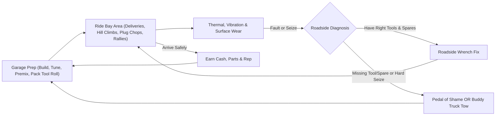
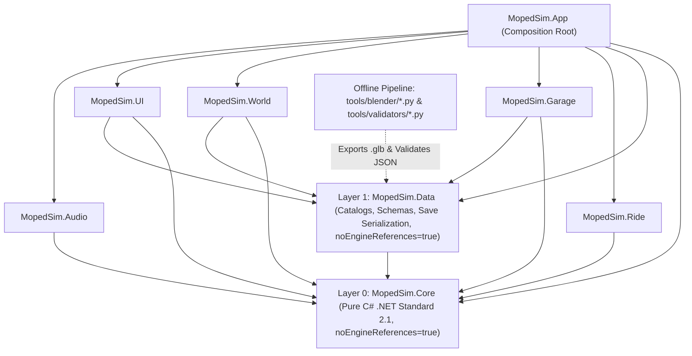

# PROJECT_GUIDE.md — MopedGame Master Engineering & Design Blueprint

> **Purpose**: This document is the single technical and mechanical source of truth for agents implementing **MopedGame**. Every gameplay system, data contract, software layer, Blender asset standard, verification gate, and milestone exit criterion is specified here so agents can build iteratively over a long-term codebase without architectural drift.
>
> **See Also**: [AGENTS.md](../AGENTS.md) (rules & workflow) · [ARCHITECTURE_DECISIONS.md](ARCHITECTURE_DECISIONS.md) (settled ADRs) · [ROADMAP_STATUS.md](ROADMAP_STATUS.md) (setup & milestone tracker)

---

## 1. Vision & "The Moped Rider Feeling"

MopedGame is **not** a sterile racing sim or a generic motorcycle game. It is a **49cc–70cc 2-stroke love letter** set across a stylized **San Francisco / Oakland Bay Area**—capturing the joyful absurdity, mechanical intimacy, and roadside camaraderie of riding vintage pedal-equipped mopeds until something rattles loose, overheats, or clogs miles from home.

### Core Pillars

1. **Ride Until It Breaks (Mechanical Vulnerability & Roadside Resourcefulness)**
   - Your bike is alive and imperfect: head nuts back off over West Oakland potholes, 6V condensers hate stop-and-go heat, rust flakes sneak past a dirty petcock, and sustained WOT pulls up Tunnel Road spike Cylinder Head Temperature (`CHT`) toward soft-seize territory.
   - Carrying spares and tools in a **limited-capacity Tool Roll** (spark plug wrench, spare B6HS/B7HS plug, spare master link, flathead, needle-nose, feeler gauge, 10mm wrench) creates meaningful risk/reward trade-offs before every ride.
   - When a breakdown beats your roadside kit, you endure the **Pedal of Shame** (human leg power + stamina at 8–12 mph) or burn cash calling the **Buddy Truck Tow** back to the garage.
2. **Authentic 2-Stroke Wrenching & Tuning**
   - Real 2-stroke cause-and-effect, readable through sensory cues rather than opaque spreadsheets:
     - **Carb Jetting & Plug Chops**: Hold WOT down a flat straight, hit the kill switch, pull the plug, and read the ceramic insulator color (`ChalkWhite` = dangerously lean → `ChocolateBrown` = dialed → `WetBlack` = rich/four-stroking).
     - **Air Leaks**: Torn crank seals or loose intake clamps spike idle RPM, lean out mixture, and drive CHT upward.
     - **Powerbands & Drivetrains**: Swapping a stock baffled pea-shooter for an expansion chamber transforms the bike from flat, tractor-like low-end pull into a screaming high-RPM powerband surge—requiring clutch spring or variator roller re-tuning so the engine actually hits the pipe.
     - **Physical Disassembly Order**: You cannot yank a cylinder off while the head nuts, exhaust flange, and intake are bolted on; bolts strip if over-torqued and seize if rusted.
3. **Dynamic & Joyful Bay Area Riding**
   - Mopeds weigh **45–60 kg**: nimble, flickable, deeply sensitive to **hills, headwinds, rider aero tuck** (+3–4 mph flat-out gain), **pedal-assist torque** off the line or up 18% SF hills, **surface hazards** (shallow-angle Muni steel rail tracks, pothole patches, wet fog asphalt), and **downhill drum brake fade**.
4. **Interactive Garage & Personal Expression**
   - A cozy, tactile West Oakland garage with a hydraulic/floor workstand, carburetor workbench, milk-crate parts stash, premix jerrycan station, catalog terminal, rattle-can paint booth, and a DIY center-stand / roller test rig.
   - Customization changes both silhouette and function: handlebars (low clip-ons improve aero tuck; tall BMX bars reduce tuck bonus but improve rough-road control), milk crates / rear racks (expand delivery cargo slots), headlights (dim 6V flicker vs. 12V LED conversion), paint & patina.

### Fictionalized Chassis Archetypes (v1 Roster)
To capture authentic mechanical diversity without trademark encumbrance, v1 ships three distinct homage archetypes:

| Archetype ID | Name | Inspired By | Drivetrain Architecture | Personality & Trade-offs |
| :--- | :--- | :--- | :--- | :--- |
| `arch_maxer_e50` | **Maxer E50** | Puch Maxi E50 | Single-speed wet centrifugal clutch | Bulletproof simplicity, iconic step-through frame, huge aftermarket 70cc/pipe potential, struggles up steep SF hills without gearing/clutch tuning. |
| `arch_bramble_pa50` | **Bramble PA50** | Honda Hobbit / Camino | Dual-pulley **variated belt drive** + reed intake | Rocket hill climber when variator roller weights and contra spring match the pipe's powerband; belt wear/slip and complex pulley tuning. |
| `arch_targa_a35` | **Targa A35** | Tomos A35 | **2-speed automatic** gearbox (1st → 2nd sprag clutch) | Crisp off-the-line launch + solid top speed; quirky 2nd-gear shift clunk, transmission ATF oil checks, sprag/clutch cork wear. |

### Explicit Non-Goals (Scope Guardrails)
- **No 1:1 photoreal satellite Bay Area**: The map is a compressed, stylized playground (~3 km × 3 km playable footprint) prioritizing iconic landmarks, grade changes, road feel, and sightlines over block-by-block realism.
- **No online multiplayer in v1**: Single-player experience; architecture remains deterministic for potential future ghosts/leaderboards.
- **No modern 4-stroke motorcycles or multi-cylinder gearboxes**: Focused strictly on 1-cylinder pedal-equipped 2-stroke mopeds.
- **No punishing zero-guidance simulation**: Players can toggle **Mechanic Diagnostic Hints** (subtle audio/symptom callouts) in settings without diluting core simulation fidelity.

---

## 2. Core Gameplay Loop & Systems Specification



### 2.1 Two-Stroke Mechanical Simulation Spec (`MopedSim.Core`)

Every active moped runs a deterministic fixed-timestep simulation (`dt = 1/60s` or `1/120s` substeps for drivetrain/engine stability). All parameters below live in `EngineState`, `FuelState`, `ThermalState`, `IgnitionState`, `DrivetrainState`, and `ChassisWearState` inside `MopedSim.Core`.

#### A. Carburetion, Air-Fuel Ratio (AFR) & Air Leaks
- **Inputs**:
  - `ThrottlePosition` (`0.0..1.0`)
  - `ChokeEngaged` (`bool`, enriches cold starts; chokes warm engine)
  - `MainJetSize` (e.g., `#52`..`#98`), `PilotJetSize` / `IdleScrewTurns`, `NeedleClipPosition` (`1..5`)
  - `AirFilterRestriction` (`0.0` velocity stack / open mesh → `0.18` oiled foam → `0.45+` clogged dirty filter)
  - `AirLeakSeverity` (`0.0..1.0`, sum of loose intake clamp, torn base gasket, or worn crank seal)
  - `AmbientAirDensity` (varies by zone elevation & Karl the Fog humidity/coolness)
- **Core Rule**:
  - Ideal 2-stroke target AFR is ~`12.5:1`–`13.2:1` under load.
  - **Air Leaks** inject unmetered air downstream of the carb, raising `EffectiveAfr` toward lean (`> 14.8:1`) especially at idle/low throttle → causes **hanging high idle**, bog on crack-open throttle, and rapid `CHT` climb.
  - **Too Rich (`EffectiveAfr < 11.2:1`)**: Induces **four-stroking** (blubbery miss-every-other-cycle sound, sluggish top-end, wet soot buildup on plug, extra exhaust smoke).
  - **Too Lean (`EffectiveAfr > 14.5:1`)**: Sharp initial snap followed by flat/hollow bog under load, rising `CHT`, pre-ignition ping, and eventual piston seizure.
  - **Venturi-Aware Jetting** (`EngineSimulation.ComputeIdealMainJet`): the ideal main jet scales with displacement, pipe flow, and the carb's venturi bore *relative to the engine's matched venturi* (`12mm @ 49cc`, `~15mm @ 70cc`, `~19mm @ 100cc`; `matched = 12mm × (cc/49)^0.625`, `venturiScale = (venturi/matched)^0.90`). An oversized venturi flows the same air at lower velocity (weaker metering signal) and needs a bigger jet, so stock targets are: `49cc / 12mm Bing ≈ #58`, `49cc / 15mm SHA ≈ #70`, `70cc kit / 15mm SHA + performance pipe ≈ #72`. Stock catalog jetting (`Maxer E50` 12mm/#56, `Bramble PA50` 15mm/#68, `Targa A35` 15mm/#66) runs `~12.5–13.0:1` at 60% throttle for 60s without fouling or stalling (asserted in `MopedSim.Data.Tests`).

#### B. Premix Lubrication & Cylinder Head Temperature (`CHT`)
- **Fuel Tank Premix**: Player mixes pump gas + 2-stroke oil at the Garage Premix Station (e.g., `50:1` synthetic, `40:1` standard, `32:1` break-in/heavy load, or accidental **Straight Gas `0:1`** mistake!).
- **CHT Thermal Zones (°C)**:
  - `< 70°C`: **Cold Engine** (needs choke to fire cleanly; rough throttle response if revved hard cold).
  - `120°C – 185°C`: **Optimal Operating Temp** (clean burn, reliable ring seal).
  - `186°C – 205°C`: **Running Hot** (heat-soak starts threatening weak 6V condensers; subtle power loss).
  - `206°C – 229°C`: **Lean Warning / Ping Zone** (audible metallic knock/detonation spikes; ring wear accelerates 5x).
  - `230°C – 254°C`: **Soft Seize (4-Corner Heat Seize)** (piston swells, engine bogs and stalls softly; cools down after ~45–90s on the curb and can re-start with reduced compression).
  - `>= 255°C` or **Oil Starvation (`PremixRatio < 0.008` sustained)**: **Hard Seize** (rear wheel locks briefly unless clutch/decompressor pulled, piston/cylinder scored, compression drops below start threshold → requires top-end rebuild in garage).

#### C. Spark Plug Reading ("Plug Chop")
- `SparkPlugState` tracks `ElectrodeGapMm`, `FoulingLevel` (`0..1`), and `InsulatorColorIndex` (`0.0` = `ChalkWhite` → `0.5` = `ChocolateBrown` → `1.0` = `WetBlack`).
- `InsulatorColorIndex` integrates recent **high-throttle (>80% TPS) AFR** weighted by heat range (`B6HS` hot vs. `B8HS` cold plug for kitted 70cc engines) and oil richness.
- Removing the plug in the Garage (or roadside inspection) freezes its diagnostic snapshot cleanly, matching real-world plug-chop tuning!

#### D. Ignition & Electrical System
- **6V Points & Condenser (Stock)**:
  - `PointsGapMm` drifts gradually with rubbing-block wear; outside `[0.30, 0.45] mm` causes misfire at high RPM or no-spark.
  - **Condenser Heat-Soak**: Weak/aged condensers lose capacitance above `95°C` crankcase temp → classic "runs great for 12 minutes, dies at a stoplight, miraculously restarts 20 minutes later once cool."
  - Headlight brightness scales with engine RPM (dim amber flicker at idle).
- **12V Electronic CDI (Upgrade)**:
  - Eliminates points drift & condenser heat-soak; crisp spark past `10,500+ RPM`; steady bright headlight.

#### E. Fuel Delivery & Petcock
- `FuelTankState`: Capacity (liters), `FuelLevelLiters`, `ReserveThresholdLiters` (typically last `0.6 L`), `RustContamination` (`0..1`), `PetcockMode` (`Off | On | Reserve`), `HasInlineFilter` (`bool`).
- Float bowl holds small buffer (~`0.04 L`) so bike sputters ~150m after turning petcock `Off` or running dry on `On`, giving realistic warning to flip down to `Reserve` mid-ride!
- Without an inline filter on a rusty tank, `RustContamination` stochastically causes `CloggedMainJet` or `StuckFloatNeedle` (overflowing fuel drip).

#### F. Exhaust & Powerband Curves
- Defined in `data/catalogs/parts.json` via piecewise-linear torque multiplier curves keyed by RPM (`TorqueCurveSamples`):
  - **Stock Baffled**: Smooth low-end torque from `2,500–5,800 RPM`, hits brick wall above `6,200 RPM`; gradually accumulates carbon if over-oiled (`CarbonClog > 0.6` chokes top speed).
  - **Circuit Pipe**: Broad midrange (`4,500–7,800 RPM`), ideal for SF hills and variators.
  - **Top-End Expansion Chamber**: Hollow below `5,500 RPM`, explosive **powerband hit** from `6,500–9,800 RPM` (loud metallic "braaap" resonance); needs stiffer clutch springs or lighter variator rollers so the engine doesn't bog out of corners.

#### G. Drivetrain & Pedal Mechanics
- **Pedal Start & Decompressor**: Pedaling cranks the engine above kick-start engagement RPM; engaging the decompressor valve eases pedaling resistance and shuts off the bike cleanly.
- **Single-Speed (`Maxer E50`)**: Centrifugal clutch engages at `ClutchEngageRpm` (tuned by spring stiffness); heavy slip on steep SF hills heats up clutch pads.
- **Variated (`Bramble PA50`)**: Front variator ramps out with RPM modulated by `RollerWeightGrams`; rear torque driver modulated by `ContraSpringRate`; belt slips if oil-contaminated or snaps near `Wear >= 1.0`.
- **2-Speed Auto (`Targa A35`)**: Gear ratios `G1` → `G2` shift at load-adjusted RPM threshold; low transmission oil accelerates clutch cork glazing.
- **Final Drive**: Front/rear sprocket teeth (`11T/45T` hill-climbing vs `16T/38T` flat-out top speed), chain slack (`ChainSlackMm` — too loose risks thrown chain; too tight binds wheel bearing).

---

### 2.2 Assembly & Fastener Dependency Graph (`BikeAssemblyGraph`)

`MopedSim.Core` represents every bike as a directed acyclic graph of **Mount Slots** and **Fasteners**:

```text
SLOT_FRAME (Root)
├── SLOT_FORK_ASSEMBLY (BOLT_STEM_NUT)
│   ├── SLOT_FRONT_WHEEL (BOLT_FRONT_AXLE_L/R, SLOT_FRONT_BRAKE_CABLE)
│   ├── SLOT_HANDLEBARS (BOLT_BAR_CLAMP_1..4, SLOT_THROTTLE_CABLE, SLOT_HEADLIGHT)
│   └── SLOT_FRONT_FENDER
├── SLOT_REAR_SUSPENSION (BOLT_SHOCK_TOP_L/R, BOLT_SHOCK_BOT_L/R)
├── SLOT_REAR_WHEEL (BOLT_REAR_AXLE_L/R, SLOT_CHAIN, SLOT_REAR_SPROCKET, SLOT_REAR_BRAKE -> SLOT_REAR_BRAKE_CABLE)
├── SLOT_SEAT (BOLT_SEAT_POST)
├── SLOT_CARGO_RACK (BOLT_RACK_1..2)
├── SLOT_FUEL_TANK (SLOT_PETCOCK -> SLOT_FUEL_LINE -> SLOT_INLINE_FILTER)
└── SLOT_ENGINE_CRADLE (BOLT_ENGINE_MOUNT_1..3)
    ├── SLOT_IGNITION (stator plate: Points/Condenser or CDI) + SLOT_FLYWHEEL (BOLT_FLYWHEEL_NUT)
    ├── SLOT_DRIVETRAIN_SIDE (BOLT_CLUTCH_COVER -> Clutch/Variator/Gearbox; PA50: SLOT_VARIATOR_ROLLERS, SLOT_VARIATOR_BELT)
    ├── SLOT_INTAKE_MANIFOLD (BOLT_INTAKE_1..2, SLOT_INTAKE_GASKET)
    │   └── SLOT_CARBURETOR (BOLT_CARB_CLAMP)
    │       ├── SLOT_MAIN_JET (requires Float Bowl open)
    │       └── SLOT_AIR_FILTER (BOLT_FILTER_CLAMP)
    └── SLOT_CYLINDER (requires Head removed, Exhaust removed, Intake removed!)
        ├── SLOT_PISTON (requires Cylinder removed; validates ArrowTowardExhaust + RingGap)
        ├── SLOT_CYLINDER_HEAD (BOLT_HEAD_NUT_1..4, SLOT_HEAD_GASKET)
        │   └── SLOT_SPARK_PLUG (THREAD_SPARK_PLUG)
        └── SLOT_EXHAUST (BOLT_EXHAUST_FLANGE_1..2, BOLT_EXHAUST_FRAME_BRACKET, SLOT_EXHAUST_GASKET)
```

Slot and fastener IDs are used verbatim across `data/catalogs/archetypes.json`, Blender `SOCKET_*`/`BOLT_*` nodes, and Core's `SlotIds` / `FastenerIds` constants. Every Core constant is mounted/declared by at least one catalog archetype and every catalog slot has a `SlotIds` constant (enforced by `MopedSim.Data.Tests`), so Unity `SlotSocketBindings` never uses raw slot strings.

**Enforced Wrenching Rules**:
1. **Precondition Validation**: Attempting to remove `SLOT_CYLINDER` while `BOLT_HEAD_NUT_1` is installed or `SLOT_EXHAUST` is mounted returns `WrenchActionResult.Blocked(blockingNodes)`. `TrySwapPart` fits a replacement part directly across the target slot's own healthy fasteners (preserving existing fastener torque while still blocking on stripped/seized slot fasteners or external blocking slots; failed replacement restores the original part; `TryRemovePart` remains strict).
2. **Torque Windows**: Each fastener defines `TargetTorqueNm` (e.g., `12 Nm` for M7 cylinder head nuts), `ToleranceNm`, and `StripThresholdNm`.
   - Under-torqued (`< Target - Tolerance`): Increases vibration loosening rate (`2.5x` multiplier) and gasket leak risk (`AirLeakSeverity` / `ExhaustLeak`).
   - Over-torqued (`> StripThreshold`): Marks bolt `IsStripped = true` (requires Helicoil/tap repair in garage).
3. **Seized & Rusty Fasteners**: Exhaust flange nuts can spawn or age into `IsSeized = true`; forcing them with a plain wrench snaps/strips the stud unless **Penetrating Oil** is applied first.
4. **Vibration Loosening**: Every pothole impact and high-RPM 2-stroke buzz gradually loosens fasteners proportional to `ChassisVibration` (properly torqued in-spec fasteners loosen at a minimal `5%` baseline rate, while under-torqued fasteners unwind at `2.5x`).

---

### 2.3 Fault Taxonomy & Roadside Loop

| Fault ID | Root Cause | Observable Symptoms | Roadside Tool / Spare Needed | Garage Permanent Fix |
| :--- | :--- | :--- | :--- | :--- |
| `fault_fouled_plug` | Rich AFR, heavy premix, cold idling | Sputter, miss under load, sudden stall, wet black electrode | Spark Plug Wrench + Wire Brush OR Spare Plug | Re-jet carb / adjust premix ratio |
| `fault_clogged_jet` | Tank rust + no inline fuel filter | Runs on choke only, dies when cracking throttle | Flathead + Carb Cleaner / Blow-out | Install Inline Fuel Filter + Flush Tank |
| `fault_condenser_heatsoak` | Aged 6V condenser + hot crankcase (`>95°C`) | Random cutout after ~12 min hot riding; restarts when cooled | Cool down wait (or spare Condenser + Flywheel Puller) | Replace Condenser or upgrade to 12V CDI |
| `fault_points_drift` | Rubbing block wear on 6V points | High-RPM breakup, backfire, weak spark | Flathead + Feeler Gauge (`0.35mm`) | Replace Points or upgrade to 12V CDI |
| `fault_air_leak` | Loose carb clamp / torn base gasket / crank seal | Racing high idle, lean bog, fast CHT spike | 10mm Wrench / Flathead (clamp) | Replace Gasket / Crank Seal (pressure test) |
| `fault_thrown_chain` | Excessive chain slack + pothole shock | Loud clatter, engine free-revs with zero wheel drive | Master Link + Needle-Nose Pliers + 15mm Axle Wrench | Replace stretched chain + set slack + tensioners |
| `fault_snapped_belt` | Worn variator belt (`Bramble PA50`) | Engine screams to redline, zero forward motion | Spare V-Belt + Variator Strap/Tool | Replace belt + inspect pulley faces |
| `fault_exhaust_loose` | Vibration loosened M6 exhaust flange nuts | Deafening unmuffled pop, sudden torque drop | 10mm Wrench + Spare Flange Nut | Replace copper crush gasket + torque + lock-nut |
| `fault_soft_seize` | `CHT >= 230°C` (lean jet / steep SF hill WOT) | Sudden bog & silent stall; compression feels sticky initially | Curb cool-down (60s) + up-jet / enrich needle if carrying jets | Proper jetting, heat-range plug, cooling fins check |
| `fault_hard_seize` | `CHT >= 255°C` or `0:1` straight gas | Rear wheel lockup, metallic screech, compression lost | **Not field-repairable** → Pedal of Shame or Buddy Tow | New Piston/Ring/Cylinder Kit + hone |

**Tool Roll & Recovery Economy**:
- Standard Handlebar/Seat **Tool Roll** holds **6 slots** (upgradable to **10 slots** with saddlebag/milk-crate). The ceiling is one contract: `SimulationWorld.BaseToolRollCapacity = 6` / `MaxToolRollCapacity = 10`, mirrored by `SaveMigrator` and the `toolRollCapacity` (`6..10`) / `defaultToolRollSlots` (`<= 10`) schema bounds.
- Choosing between carrying a spare belt, extra jets, spare plug, or master link + wrenches creates genuine pre-ride preparation tension.
- **Pedal of Shame**: Disengage drive/pedal mode lets any pedal-equipped moped limp back at ~8–12 mph using `RiderStamina`; **Buddy Truck Tow** recovers bike instantly for a cash fee scaled by distance from West Oakland Garage.

---

### 2.4 Dynamic Bay Area Riding Model

`MopedSim.Ride` simulates lightweight 2-wheel dynamics fed directly by `BikeSimulation`'s rear-wheel torque and front/rear brake torques:
- **Lightweight Countersteer & Lean**: Mass ~`48–62 kg` dry + `75 kg` rider; responsive lean transitions (`MaxLeanDeg ~ 38°`), authentic low-speed wobble if overloaded or low tire pressure.
- **Rider Aero Tuck**: Holding Tuck lowers drag area `CdA` by ~30% (`BikeSimulation.AeroTuckCdAMultiplier = 0.70f`, yielding `+3 to +4 mph` on flat straights and downhills), reduced if running tall ape/BMX bars; obscures immediate peripheral road clutter slightly for visceral speed sensation.
- **Pedal-Assist**: Tapping/holding Pedal adds human torque (`~120–180 W` burst scaled by `RiderStamina`) to climb steep SF hills (`15%–22%` grades) or launch sluggish high-geared bikes off stoplights.
- **Independent Front & Rear Brakes + Drum Fade**: Cable drum brakes overheat on long descents (e.g., Grizzly Peak / Twin Peaks), temporarily reducing braking coefficient until cooled (upgradable to EBC shoes or hydraulic front disc conversion).
- **Surface & Hazard Matrix**:

| Surface Type | Rolling Drag | Grip Multiplier | Special Mechanical / Riding Effect |
| :--- | :--- | :--- | :--- |
| `DryAsphalt` | `1.0x` | `1.00` | Clean baseline riding |
| `PatchedPotholeAsphalt` | `1.08x` | `0.90` | Vertical suspension impulse + accelerates `VibrationLoosenRate` on loose bolts |
| `WetAsphalt` (Fog/Mist) | `1.10x` | `0.76` | Longer braking distance; slight moisture misfire risk on exposed pod filters |
| `SteelRailTrack` (SF Muni) | `0.95x` | `0.38` | Crossing at shallow angle (`< 20°`) triggers strong front/rear lateral slip & tank-slapper risk |
| `GravelShoulder` | `1.35x` | `0.62` | Heavy drag, dusty roost particle trail, high chain dirt wear |

---

### 2.5 Interactive Garage, Customization & Progression

#### Garage Stations (`Garage.unity`)
1. **Work Stand**: Mounts active bike; orbit/zoom inspection camera, explode/xray toggle for occluded parts, click bolts/parts to wrench with torque gauge feedback.
2. **Workbench**: Rebuilds removed carburetors, swaps main/pilot jets & needle clips, runs **Plug Chop Color Chart** comparisons, cleans points/filters.
3. **Tool Pegboard & Tool Roll Packing**: Upgrade wrenches (basic → torque wrench → impact/flywheel puller → leak-down tester) and choose what fits into the active **Tool Roll**.
4. **Milk-Crate Parts Inventory**: Owned new, used, and worn/scored parts; track mileage and condition per component.
5. **Premix Jerrycan Station**: Mix fuel batches (`32:1`, `40:1`, `50:1`, or accidental unmixed gas) and fill bike tank.
6. **Center-Stand / DIY Roller Dyno**: Spin the engine in the garage to hear jetting changes, watch RPM vs. Wheel Speed & CHT under simulated drag load, and catch air leaks before hitting Oakland streets.
7. **Paint & Aesthetic Booth**: Frame/tank rattle-can colors, metallic flake, weathered patina slider, bar swaps, seats, headlights, baskets/milk crates.

#### Progression & Economy Loops
- **Bay Area Courier Gigs**: Timed hot-food/parcel runs whose payout scales with distance, hill difficulty, and intact cargo (requiring milk-crate/rack capacity).
- **Hill-Climb & Flat-Out Challenges**: West Oakland Embarcadero 1/4-mile speed trap (plug-chop paradise) and SF Twin Peaks / Oakland Tunnel Rd climb trials.
- **Weekend Moped Rallies ("Bay Swarm")**: Group rides with AI moped pack riders following route checkpoints—survive the group pace without seizing or falling off the back!
- **Parts Economy**: Order crisp aftermarket parts from the catalog terminal or buy sketchy/cheap swap-meet parts (which may hide rusty tanks or stripped threads until inspected).

---

### 2.6 Compressed Stylized Bay Area World Design (`Zone_*`)

To preserve fast frame rates, rich density, and clean scene separation (`ADR-004`), the world uses **4 additive neighborhood zones** (~3 km × 3 km total playable loop):

1. **`Zone_WestOakland` (Home Base & Flats)**
   - Industrial brick warehouses, BART overpass pillars, flat straightaways ideal for plug chops, West Oakland Garage entrance, and Swap Meet / Parts Alley.
2. **`Zone_OaklandHills` (Thermal & Brake Torture Test)**
   - Lake Merritt shoreline warm-up leading into steep winding redwood/eucalyptus climbs (Tunnel Rd / Grizzly Peak homage) with scenic bay overlooks and long downhill brake-fade switchbacks.
3. **`Zone_BayCrossing` (Wind & Top-Speed Run)**
   - Stylized bike/service span across the Bay with strong crosswinds/headwinds, long sustained WOT pull exposing lean jetting, and Ferry Terminal hub.
4. **`Zone_SF_Mission` (Hills, Muni Rails & Karl the Fog)**
   - Embarcadero waterfront, Mission/Valencia street corridors with **steel Muni tracks**, double-parked delivery vans, steep `15%–22%` Nob/Twin Peaks climbs, and dynamic **Karl the Fog** coastal mist bank lowering visibility and cooling air density (`AmbientAirDensity` enrichment/leaning shift).

---

### 2.7 Audio & Sensory Feedback Spec (`MopedSim.Audio`)

Sound is a **primary diagnostic instrument** in a moped game—players must hear problems before checking HUD numbers:
- **RPM & Load Synthesis/Layering**: Seamless pitch + harmonic layer blend driven by `EngineTelemetrySnapshot.Rpm` and `ThrottlePosition`.
- **Two-Stroke Signature Cues**:
  - **Four-Stroking Blubber**: Amplitude-modulated stutter (`18–35 Hz`) whenever `EffectiveAfr < 11.2`.
  - **Powerband Pipe Resonance**: High-Q metallic ring burst entering the installed exhaust's peak RPM window.
  - **Lean Pre-Seize Ping**: Sharp irregular metallic ticks when `CHT > 206°C` or `DetonationRisk > 0.3`.
  - **Exhaust Flange Leak**: Unmuffled low-end "pop-pop" pulse proportional to `ExhaustLeakSeverity`.
  - **Drivetrain & Chassis**: Centrifugal clutch chatter on launch, 2-speed shift clunk, chain slap on potholes, belt squeal, drum brake squeak, wind roar scaling with aero tuck speed.

---

## 3. Technology Stack & Local Environment

| Layer | Technology Choice | Rationale & Constraints |
| :--- | :--- | :--- |
| **Game Engine** | **Unity 6 LTS** (URP 3D, `arm64` native) | Text-diffable C#/YAML/JSON workflow; fits within 54 GiB host disk (`ADR-001`). |
| **Core Logic** | **.NET Standard 2.1 / C# 9.0** (`MopedSim.Core`, `MopedSim.Data`) | Zero `UnityEngine` refs; <2s headless `dotnet test`; strict Unity 6 compiler parity (`ADR-002`). |
| **Serialization** | `Newtonsoft.Json` (`com.unity.nuget.newtonsoft-json`) | Shared between `.NET` tests and Unity runtime; supports polymorphic/versioned schemas. |
| **3D Asset Pipeline** | **Blender CLI (Python)** → `.glb` + `com.unity.cloud.gltfast` | Reproducible scripted geometry + `SOCKET_*` empties verified headlessly in Python (`ADR-005`). |
| **Validation & CI** | Python `3.x` (`tools/validators/`) + Unity Test Framework | Zero-dependency schema/mesh/boundary checks + headless Unity EditMode/PlayMode CLI runs. |
| **VCS & LFS** | Git + `git-lfs` | Tracks `.glb`, `.wav`/`.ogg`, `.png` textures cleanly without bloating git history. |

---

## 4. Software Architecture & Separation of Concerns

### 4.1 Layered Dependency Architecture



### 4.2 Assembly Dependency Matrix (Enforced by `.asmdef` & Gate 2)

| Assembly | May Reference | Forbidden References |
| :--- | :--- | :--- |
| `MopedSim.Core` | .NET Standard 2.1 BCL only | `UnityEngine`, `UnityEditor`, `MopedSim.Data`, any `Unity` assembly |
| `MopedSim.Data` | `MopedSim.Core`, `Newtonsoft.Json` | `UnityEngine`, `UnityEditor`, presentation assemblies |
| `MopedSim.Ride` | `MopedSim.Core`, `Unity.InputSystem` | `MopedSim.Garage`, `MopedSim.UI`, `MopedSim.Data` directly |
| `MopedSim.Garage` | `MopedSim.Core`, `MopedSim.Data`, `glTFast` | `MopedSim.Ride`, `MopedSim.World` |
| `MopedSim.World` | `MopedSim.Core`, `MopedSim.Data` | `MopedSim.Garage`, `MopedSim.UI` |
| `MopedSim.Audio` | `MopedSim.Core` | `MopedSim.Garage`, `MopedSim.World`, `MopedSim.Data` |
| `MopedSim.UI` | `MopedSim.Core`, `MopedSim.Data` | Physics internals (`MopedSim.Ride`), `MopedSim.World` internals |
| `MopedSim.App` | All runtime `MopedSim.*` assemblies | `UnityEditor` |
| `MopedSim.Editor` | All assemblies + `UnityEditor` | Shipped in runtime player builds |

### 4.3 Core ↔ Unity Public Interfaces (`MopedSim.Core`)

Future agents implementing `MopedSim.Core` and Unity adapters MUST honor these stable boundary types (keep `EngineTelemetrySnapshot` an immutable `readonly struct` to guarantee zero GC allocation per `FixedUpdate`):

```csharp
namespace MopedSim.Core
{
    public interface ISimRandom
    {
        double NextDouble();
        int NextInt(int minInclusive, int maxExclusive);
    }

    public readonly struct RideInputState
    {
        public readonly float Throttle;        // 0..1
        public readonly float FrontBrake;      // 0..1
        public readonly float RearBrake;       // 0..1
        public readonly float Steer;           // -1..1
        public readonly bool AeroTuck;
        public readonly bool PedalAssist;
        public readonly bool Choke;
        public readonly bool Decompressor;
        public readonly float RoadSlopeRadians;
        public readonly float SurfaceGrip;
        public readonly float SurfaceRoughness;
        public readonly float AmbientAirDensity;
    }

    public readonly struct EngineTelemetrySnapshot
    {
        public readonly float Rpm;
        public readonly float RearWheelTorqueNm;
        public readonly float EngineBrakeTorqueNm;
        public readonly float EffectiveAfr;
        public readonly float ChtCelsius;
        public readonly float FuelLitersRemaining;
        public readonly bool IsReserveActive;
        public readonly bool IsFourStroking;
        public readonly bool IsDetonating;
        public readonly bool IsPowerbandActive;
        public readonly bool IsStalled;
        public readonly bool IsSeized;
        public readonly float ExhaustLeakFactor;
        public readonly float HeadlightOutput; // 0..1
        public readonly int CurrentGear;       // 0=idle/clutch open, 1..2
    }

    public sealed class BikeSimulation
    {
        public EngineTelemetrySnapshot Step(float dt, in RideInputState input, ISimRandom rng);
        public WrenchActionResult TryRemovePart(string slotId);
        public WrenchActionResult TryInstallPart(string slotId, PartInstance part);
        public WrenchActionResult TryTorqueFastener(string fastenerId, float torqueNm);
        // Save/load only: restores torque/strip/seize/oil verbatim without wrenching side effects (never re-strips).
        public WrenchActionResult RestoreFastenerState(string fastenerId, bool isInstalled, float currentTorqueNm,
            bool isStripped, bool isSeized, bool penetratingOilApplied);
        public void Refuel(float liters, float premixOilFraction, float tankRustContamination = -1f);
        public SparkPlugReading InspectSparkPlug();
    }

    public sealed class SimulationWorld
    {
        // The only way Unity spends garage cash on parts; never deduct CashUsd directly.
        public PurchaseResult TryPurchasePart(PartDefinition part);
    }
}
```

- **Fresh-bike fuel**: `BikeArchetypeSpec.DefaultFuelLiters / DefaultPremixOilFraction / DefaultPetcockMode / DefaultTankRustContamination` hydrate every new `BikeSimulation`. `MopedSim.Data` fills them from the catalog `defaultFuelMix`, converting the authored `X:1` premix ratio to Core's oil fraction via `ThermalModel.PremixFromRatio` (`50:1 → 0.02`). Tank rust is stored on the tank `PartInstance`.
- **Part categories**: every catalog category maps to a dedicated `PartCategory` (`FuelLine`, `VariatorRoller`, `Fender`, `Brake`, `Cable`, `PremixOil`, `GarageStation` included; `Tool`/`Spare` → `ToolRollItem`), so Core's category check alone keeps cables, fenders, and brakes apart.

### 4.4 Data Schema Contracts (`data/schemas/` & `data/catalogs/`)

- **Dry mass**: an archetype's `baseDryMassKg` is the whole stock bike. Stock (default) part `massKg` values sum `2–6 kg` below it; `MopedSim.Data` passes only that residual (frame hardware, wiring, stand) to Core as `BikeArchetypeSpec.BaseDryMassKg`, so assembled dry mass equals the authored value (`46.5–52.5 kg`) and the `2.0 kg` residual floor never engages.
- **Player builds**: players cannot reach the repo's `data/catalogs/`, so `MopedSim.Editor.CliBuild` stages `data/catalogs/*.json` into `unity/Assets/StreamingAssets/Catalogs/` (validated, git-ignored) before every build; `AppCompositionRoot` loads from there outside the Editor.

Example part catalog entry (`data/catalogs/parts.json` conforming to `data/schemas/part.schema.json`):

```json
{
  "schemaVersion": 1,
  "id": "pipe_circuit_e50_proma",
  "displayName": "Bay Circuit Torque Pipe",
  "category": "Exhaust",
  "compatibleInterfaces": ["E50_ExhaustFlange_2Bolt"],
  "meshAssetPath": "Models/Parts/Exhaust/pipe_circuit_e50_proma.glb",
  "requiredSockets": ["SOCKET_EXHAUST_FLANGE", "SOCKET_EXHAUST_BRACKET"],
  "massKg": 2.4,
  "priceUsd": 135,
  "stats": {
    "flowEfficiency": 1.18,
    "peakRpmStart": 4800,
    "peakRpmEnd": 7900,
    "noiseDb": 92,
    "torqueCurve": [
      { "rpm": 2500, "multiplier": 0.85 },
      { "rpm": 5500, "multiplier": 1.24 },
      { "rpm": 7800, "multiplier": 1.16 },
      { "rpm": 9500, "multiplier": 0.70 }
    ]
  }
}
```

Every save file (`save_state.json`) MUST include `"schemaVersion": 1`, `"seed": <uint>`, `"cashUsd": <decimal>`, `"bikes": [...]`, `"inventory": [...]`, `"activeToolRoll": [...]`, and `"completedGigs": [...]`, migrated sequentially by `SaveMigrator` in `MopedSim.Data`.

---

## 5. Blender Procedural Asset Pipeline & Art Standards

### 5.1 Stylized Art Direction & Export Rules
- **Visual Style**: Clean, readable low/mid-poly silhouettes with crisp beveled edges, stylized metallic/anodized/rattle-can paint contrast, and warm Bay Area golden-hour vs. cool coastal-fog lighting. Avoid noisy photoreal micro-textures that bloat memory and clash with stylized geometry.
- **Strict Export Spec (`tools/blender/`)**:
  - Format: Binary glTF 2.0 (`.glb`) with `export_yup=True` (`+Y` up, `+Z` forward, `+X` left/right symmetric around `X = 0`).
  - Scale: Metric **`1.0 unit = 1.0 meter`**, transforms applied (`scale = (1, 1, 1)`). A complete moped wheelbase MUST measure roughly `1.12 m – 1.22 m` and saddle height `0.74 m – 0.82 m`.
  - Materials: Standard glTF PBR (`BaseColor`, `Metallic`, `Roughness`, optional emissive) using shared palette lookup materials.

### 5.2 Standardized `SOCKET_*` & `BOLT_*` Contract

All attachment empties MUST exist as named glTF scene nodes on parent parts and align directly with `BikeAssemblyGraph` slot IDs:

| Parent Asset | Required Empty Nodes (`SOCKET_*` / `BOLT_*`) | Purpose |
| :--- | :--- | :--- |
| **Frame (`frame_*`)** | `SOCKET_FORK_STEERER`, `SOCKET_ENGINE_MOUNT`, `SOCKET_REAR_AXLE`, `SOCKET_SHOCK_TOP_L`, `SOCKET_SHOCK_TOP_R`, `SOCKET_SEAT_POST`, `SOCKET_FUEL_TANK`, `SOCKET_CARGO_RACK`, `SOCKET_CENTER_STAND` | Anchors major chassis sub-assemblies |
| **Fork (`fork_*`)** | `SOCKET_FRONT_AXLE`, `SOCKET_HANDLEBAR_CLAMP`, `SOCKET_HEADLIGHT_MOUNT`, `SOCKET_FENDER_FRONT` | Front wheel, bars, headlight, fender |
| **Crankcase (`case_*`)** | `SOCKET_CYLINDER_BASE`, `SOCKET_IGNITION_STATOR`, `SOCKET_CLUTCH_OUTPUT`, `SOCKET_CARB_INT_MOUNT`, `BOLT_ENGINE_MOUNT_1..3` | Top-end, ignition, drivetrain, intake |
| **Cylinder (`cyl_*`)** | `SOCKET_HEAD_BASE`, `SOCKET_EXHAUST_PORT`, `SOCKET_INTAKE_PORT`, `BOLT_HEAD_STUD_1..4` | Head, pipe, intake alignment & stud bolts |
| **Cylinder Head (`head_*`)** | `SOCKET_SPARK_PLUG`, `BOLT_HEAD_NUT_1..4` | Spark plug + torque wrench targets |
| **Exhaust / Carb / Wheel** | `SOCKET_EXHAUST_FLANGE`, `SOCKET_EXHAUST_BRACKET`, `SOCKET_AIR_FILTER`, `SOCKET_WHEEL_HUB`, `SOCKET_SPROCKET_MOUNT`, `BOLT_AXLE_L`, `BOLT_AXLE_R` | Fastener & accessory alignment |

### 5.3 Geometry & Triangle Budgets

| Asset Class | Max Triangles (LOD0) | Required UV Channels | Notes |
| :--- | :--- | :--- | :--- |
| Individual Small Part (plug, carb, jet, bolt, light) | `300 – 1,500 tris` | `UV0` | Clean silhouette; share palette material |
| Major Bike Assembly (frame, wheel w/ spokes, engine block, pipe) | `2,000 – 6,500 tris` | `UV0` | Spokes/fins simplified cleanly without alpha cards |
| Complete Assembled Moped (sum of mounted parts) | `<= 28,000 tris` | `UV0` | Keeps 10+ AI rally mopeds silky smooth at 60+ FPS |
| Garage Station / Tool Prop | `500 – 4,000 tris` | `UV0` | Interactive collider separate (`COL_*` or Unity primitive) |
| Bay Area Modular Road / Building Block | `400 – 3,500 tris` | `UV0` | Tileable 10m/20m road segments for smooth splines/grids |

### 5.4 Headless Generation & Zero-Dependency `.glb` Validation
- Generation entrypoint: `blender --background --python tools/blender/generate_all.py -- --out unity/Assets/Art/Models`
- Validator (`tools/validators/validate_assets.py`): Reads the `.glb` binary header (`glTF` magic + JSON chunk) in pure Python 3 and checks:
  1. Valid glTF 2.0 binary structure and non-empty mesh primitives.
  2. Triangle count `<= budget` per asset category in `data/catalogs/parts.json`.
  3. Presence of `TEXCOORD_0` (`UV0`) on every mesh primitive.
  4. Unit scale (`[1, 1, 1]`) and bounding box metric sanity (no `100x` cm-to-m mistakes).
  5. Every entry in `requiredSockets` from `data/catalogs/parts.json` exists verbatim as a glTF node in that `.glb`.

---

## 6. Engineering Practices & 5-Gate Verification Pyramid

```text
          /\        Gate 5: macOS arm64 Dev Build & Clean Boot Smoke
         /  \       Gate 4: Unity PlayMode Scenario Tests (Ride, Wrench, Save)
        /----\      Gate 3: Unity EditMode Tests (Bindings, Scene/Prefab Integrity)
       /------\     Gate 2: Python Validators (Schemas, Boundaries, .glb Sockets)
      /________\    Gate 1: dotnet test (MopedSim.Core + Data, <2s Headless)
```

### Code Quality & Clean Architecture Standards
- **Zero GC allocations in `FixedUpdate` / hot paths**: Use `readonly struct` snapshots (`EngineTelemetrySnapshot`), cached component references, and pre-allocated arrays/buffers; **never** call `GameObject.Find`, `GetComponent`, or LINQ inside `FixedUpdate`/`Update`.
- **No magic strings across systems**: Reference part IDs, slot IDs, and fault IDs through strongly-typed constants or validated catalog keys.
- **Deterministic core tests**: Every mechanical bug gets a reproducible regression unit test in `tests/MopedSim.Core.Tests/` with a fixed seed and fixed `dt` stepping.
- **Documentation Integrity**: Update [ROADMAP_STATUS.md](ROADMAP_STATUS.md) after every completed milestone or test run; create an ADR in [ARCHITECTURE_DECISIONS.md](ARCHITECTURE_DECISIONS.md) before changing architectural boundaries.

---

## 7. Phased Vertical-Slice Roadmap (`M0`–`M7`) with Verifiable Outcomes

Each milestone is a **complete, testable increment**. Do not move to the next milestone until all Exit Verification Gates of the current milestone pass cleanly.

### M0 — Walking Skeleton & CI Gates
- **Objective**: Establish the multi-layer project skeleton, local UPM pure-C# packages, Unity 6 URP project, headless Blender script smoke test, and automated `scripts/verify.sh` harness.
- **Deliverables**:
  - Install host prerequisites (`.NET SDK`, `Blender`, `git-lfs`, `Unity 6 LTS arm64`).
  - Create `src/MopedSim.Core/` & `src/MopedSim.Data/` (`package.json`, `.asmdef` with `noEngineReferences: true`, `.csproj` with `netstandard2.1`, `LangVersion 9.0`, `TreatWarningsAsErrors`).
  - Create `tests/MopedSim.Tests.sln` with smoke unit tests.
  - Initialize `unity/` (Unity 6 LTS URP) importing `src/*` via `Packages/manifest.json` + `com.unity.cloud.gltfast` + `com.unity.nuget.newtonsoft-json`.
  - Create `tools/blender/smoke_test_cube.py`, `tools/validators/validate_all.py`, `MopedSim.Editor.CliBuild`, and `scripts/verify.sh`.
- **Out of Scope**: Full bike physics, 2-stroke math, garage UI, or Bay Area maps.
- **Verifiable Outcomes**:
  1. `dotnet test tests/MopedSim.Tests.sln --configuration Release` exits `0` with `0 warnings`.
  2. `blender --background --python tools/blender/smoke_test_cube.py` generates a valid `.glb` with `SOCKET_TEST_ANCHOR` and passes `python3 tools/validators/validate_all.py`.
  3. Unity EditMode test confirms `MopedSim.Core` is callable from `MopedSim.App` inside Unity.
  4. Gate 5 produces a macOS `arm64` dev player build with zero compile errors.

### M1 — Headless 2-Stroke Simulation Kernel
- **Objective**: Implement and mathematically verify the complete engine, carb, thermal, ignition, drivetrain, fault, and assembly DAG kernel in `MopedSim.Core` + JSON catalogs in `data/` before writing complex Unity gameplay.
- **Deliverables**:
  - `BikeSimulation`, `EngineSimulation`, `FuelSystem`, `ThermalModel`, `IgnitionSystem`, `DrivetrainModel`, `BikeAssemblyGraph`, `FaultEngine`.
  - Initial `data/schemas/*.json` and `data/catalogs/*.json` covering the 3 archetypes (`Maxer E50`, `Bramble PA50`, `Targa A35`), starter kits, jets, pipes, and faults.
  - Comprehensive property, boundary, and 60-minute simulated soak tests in `tests/MopedSim.Core.Tests/` and `tests/MopedSim.Data.Tests/`.
- **Out of Scope**: 3D rendering, audio, or Unity MonoBehaviours.
- **Verifiable Outcomes**:
  1. **Determinism test**: Two `BikeSimulation` runs with identical seed + inputs over 36,000 steps (10 min simulated) produce bit-identical `EngineTelemetrySnapshot` state.
  2. **Jetting & Plug Chop test**: Lean main jet (`#54` on 70cc kit) raises `CHT > 220°C`, triggers detonation ping, shifts plug reading to `ChalkWhite`, and soft-seizes (`CHT >= 230°C`); stepping up to `#72` drops peak `CHT < 185°C` and yields `ChocolateBrown`.
  3. **Premix failure test**: Running `0:1` straight gas causes `HardSeize` within simulated operating bounds and drops cylinder compression.
  4. **Assembly DAG test**: Attempting `TryRemovePart("SLOT_CYLINDER")` fails with blocking nodes until head nuts, exhaust, and intake are removed; piston arrow backwards returns explicit installation error.
  5. **Data integrity test**: `validate_all.py` + `MopedSim.Data.Tests` verify 100% of catalog references and JSON schemas.

### M2 — Dynamic Moped Riding Prototype
- **Objective**: Make riding a lightweight 2-stroke moped feel lively, responsive, and physically distinct on a clean flat + hill test track.
- **Deliverables**:
  - `MopedSim.Ride`: Custom two-wheel raycast suspension + countersteer lean controller wired to `BikeSimulation.Step(...)`.
  - Aero tuck stance, pedal-start + decompressor + pedal-assist climb torque, independent front/rear drum brakes with fade, and chase/first-person camera polish.
  - Placeholder geometric test track (`Zone_TestOval` or initial `Zone_WestOakland` blockout) with 0%, 10%, 18% grade ramps and bump/rail surface patches.
- **Out of Scope**: Full Bay Area art, garage wrenching UI, economy/jobs.
- **Verifiable Outcomes**:
  1. PlayMode test: Starting from dead stop via pedal-start fires the engine, accelerates to flat top speed, and **Aero Tuck increases terminal speed by >= 3 mph**.
  2. PlayMode test: Climbing an `18%` incline triggers `CHT` rise and visibly improves climb speed when **Pedal-Assist** is engaged.
  3. PlayMode test: Traversing a `SteelRailTrack` patch at `10°` shallow angle induces measurable lateral slip impulse compared to `90°` perpendicular crossing.
  4. Zero GC allocations per `FixedUpdate` step verified in core telemetry bridge check.

### M3 — Interactive Garage & Wrenching Loop
- **Objective**: Build the West Oakland Garage workstand, workbench, visual assembly/disassembly driven by `BikeAssemblyGraph`, carb jet swapping, plug chops, and DIY roller test rig.
- **Deliverables**:
  - `MopedSim.Garage` + `MopedSim.UI` (`Garage.unity`, `UI_Overlay.unity`): Workstand orbit camera, highlightable bolts/parts driven by `BikeAssemblyGraph`, torque wrench hold-to-torque bar (under/in-spec/over-torque strip), carb bowl jet/needle swapping, plug chop visual color inspector, premix mixing station, and center-stand test rig.
  - `glTFast` runtime assembler mounting parts dynamically to `SOCKET_*` transforms.
- **Out of Scope**: Open-world delivery missions or full SF neighborhoods.
- **Verifiable Outcomes**:
  1. PlayMode scenario: Player cannot click-remove cylinder until head nuts, exhaust, and intake are removed; removing them allows cylinder pull and piston inspection.
  2. PlayMode scenario: Over-torquing a head nut beyond `StripThresholdNm` sets `IsStripped == true` and unlocks repair action; under-torquing induces measurable `AirLeakSeverity` / `ExhaustLeak` on center-stand test rig.
  3. PlayMode scenario: Swapping `#56` → `#68` main jet and running center-stand dyno updates `EffectiveAfr`, `Rpm`, and `PlugChop` reading cleanly.

### M4 — Breakdown, Roadside Repair & Tow Loop
- **Objective**: Connect riding wear/faults with roadside diagnostics, Tool Roll trade-offs, Pedal of Shame, and Buddy Truck Tow.
- **Deliverables**:
  - Roadside pull-over state (`MopedSim.Ride` ↔ `MopedSim.Garage` portable wrench overlay).
  - Pre-ride Tool Roll loadout selector (`6` base slots).
  - Active fault diagnostics (`fault_fouled_plug`, `fault_clogged_jet`, `fault_condenser_heatsoak`, `fault_points_drift`, `fault_air_leak`, `fault_thrown_chain`, `fault_snapped_belt`, `fault_exhaust_loose`, `fault_soft_seize`, `fault_hard_seize`).
  - Pedal-of-Shame stamina mode and Buddy Tow recovery.
- **Out of Scope**: Final Bay Area map polish or multi-bike AI rally packs.
- **Verifiable Outcomes**:
  1. PlayMode scenario: Inducing `fault_fouled_plug` stalls bike; if Tool Roll contains `SparkPlugWrench + SparePlug`, player repairs roadside and resumes ride; without wrench, repair is blocked and Pedal-of-Shame / Tow recovers to Garage.
  2. PlayMode scenario: Inducing `fault_hard_seize` blocks roadside fix, allows Pedal-of-Shame/Tow return, and persists scored cylinder state back into Garage Workstand.

### M5 — Blender Asset Kit & Audio Sensory Layer
- **Objective**: Replace blockout placeholders with cohesive procedural Blender `.glb` kits for all 3 bike archetypes, major upgrades, garage stations, and dynamic 2-stroke audio.
- **Deliverables**:
  - `tools/blender/` modular generators for `Maxer E50`, `Bramble PA50`, `Targa A35`, 50cc/70cc top-ends, Dellorto-style carb, 3 exhaust styles, wheels/bars/crates/headlights, and garage stations.
  - `MopedSim.Audio`: Procedural/layered 2-stroke synthesizer + mechanical fault Foley driven by `EngineTelemetrySnapshot`.
- **Out of Scope**: Remaining SF/Oakland world art blocks (covered in M6).
- **Verifiable Outcomes**:
  1. `blender --background --python tools/blender/generate_all.py` cleanly exports all cataloged `.glb` files.
  2. `python3 tools/validators/validate_assets.py` reports **100% pass** on tri budgets, UV0 presence, unit scale, and `SOCKET_*` parity across all catalog parts.
  3. EditMode/PlayMode check confirms every cataloged part mounts visually onto its parent `SOCKET_*` with zero console warnings and `MopedSim.Audio` reacts deterministically to four-stroking, powerband, and ping telemetry flags.

### M6 — SF / Oakland Bay Area World & Economy
- **Objective**: Build the 4 modular additive Bay Area zones, environmental dynamics, courier/hill-climb/rally progression, and shop economy.
- **Deliverables**:
  - Additive scenes: `Zone_WestOakland.unity`, `Zone_OaklandHills.unity`, `Zone_BayCrossing.unity`, `Zone_SF_Mission.unity` + seamless zone transition loader.
  - Modular Bay Area Blender prop/road kits (BART pillars, rowhouses, Victorian facades, Muni tracks, bay bridge span, fog volume).
  - Courier gigs (cargo slot checks), hill climbs, weekend Bay Swarm moped rally AI pack, parts terminal & swap meet economy, paint/customization booth.
- **Out of Scope**: Post-launch expansion districts.
- **Verifiable Outcomes**:
  1. PlayMode E2E test: Zone streaming transitions `WestOakland → OaklandHills → BayCrossing → SF_Mission` with zero null-ref errors and bounded frame time.
  2. PlayMode economy test: Accepting a 2-crate courier gig requires rear rack/milk crate installed, awards cash upon delivery in `SF_Mission`, and unlocks purchasing/installing an upgrade part in `Garage`.
  3. Environmental test: Entering `SF_Mission` Karl-the-Fog volume alters `AmbientAirDensity` / `SurfaceGrip` telemetry as specified. (`MopedSim.World.KarlTheFogVolume` trigger volumes register with `BayAreaWeatherController` while the tracked ride rigidbody is inside; overlapping banks resolve by max intensity with a horizontal edge fade.)

### M7 — Polish, Balance, Save Migrations & Release Candidate
- **Objective**: Lock save compatibility, tune progression and mechanical balance, profile performance on Apple Silicon, and produce a clean standalone macOS release candidate.
- **Deliverables**:
  - Versioned `SaveMigrator` tests (`v1` roundtrip + forward migration fixture tests).
  - Settings menu (Mechanic Diagnostic Hints toggle, audio mix, key/gamepad rebinding, graphics presets).
  - 60-minute automated thermal/economy soak test + Apple Silicon profiling pass.
- **Out of Scope**: Online features or non-macOS console certifications.
- **Verifiable Outcomes**:
  1. Full 5-gate `scripts/verify.sh --full` passes `100%` with zero warnings/errors.
  2. Standalone macOS `arm64` build launches cleanly, executes full garage → ride → breakdown → repair → save → reload cycle, and maintains target frame stability on M4 Pro.

---

## 8. Multi-Agent Execution Playbook

### Standard Agent Task Brief Template
When assigning work to a specialized implementation agent (or subagent), issue tasks in this exact structure:

```markdown
- **Task ID & Milestone**: e.g. M1-03 (Carburetor, AFR & Plug Chop Engine)
- **Owner Lane**: Core Sim Agent
- **Allowed Paths**: `src/MopedSim.Core/Fuel/`, `tests/MopedSim.Core.Tests/`
- **Forbidden Paths**: `unity/`, `tools/blender/`
- **Contracts**: Must implement `EngineTelemetrySnapshot` fields `EffectiveAfr`, `IsFourStroking`, and `SparkPlugReading` per `PROJECT_GUIDE.md` §2.1 & §4.3.
- **Verification Commands**:
  - `dotnet test tests/MopedSim.Tests.sln --configuration Release`
  - `python3 tools/validators/validate_all.py`
- **Acceptance Criteria**:
  - Lean `#54` vs optimal `#72` vs rich `#88` jet unit tests pass deterministically.
  - Zero compiler warnings; `ROADMAP_STATUS.md` updated if milestone completes.
```

### Safe Parallelization Rules
- **Parallelizable Pairs**:
  - `Core Sim Agent` + `Blender Asset Agent` (both target `data/catalogs/parts.json` schema contracts independently without touching `.unity` scenes).
  - `World Agent` (`Zone_OaklandHills`) + `Garage Agent` (`Garage.unity`) once `MopedSim.Core` interfaces (`M1`) are frozen.
- **Serialized Checkpoints**:
  - Whenever `EngineTelemetrySnapshot` or `data/schemas/*.json` changes, land the schema/contract PR first and pass Gate 1 + Gate 2 before fanning out dependent presentation lanes.
